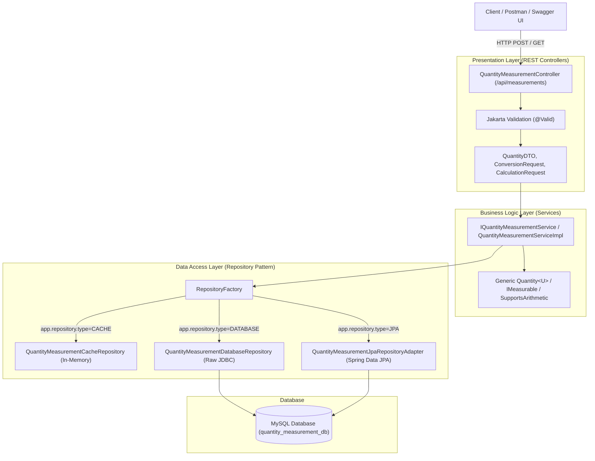

# Quantity Measurement Application

A comprehensive, production-grade Java and Spring Boot application engineered incrementally across 17 distinct Use Cases (UC1 through UC17). The project begins with fundamental object-oriented measurement modeling and equality logic, evolves into generic quantity abstraction and centralized arithmetic, and culminates in an enterprise N-tier architecture featuring Spring Web MVC RESTful APIs, flexible repository persistence (In-Memory Cache, Raw JDBC, and Spring Data JPA with MySQL), validation, content negotiation (JSON and XML), Swagger OpenAPI documentation, Actuator monitoring, and end-to-end automated testing.

The application adheres strictly to the GitFlow branching model. The `main` branch serves solely as the production documentation branch containing the `.gitignore` and this comprehensive specification. The complete application source code resides on the `dev` branch and across feature branches merged via pull requests.

---

## 1. Project Overview

In scientific, industrial, logistical, and commercial computing, handling multi-unit physical measurements (lengths, weights, volumes, and temperatures) using primitive numerical types inevitably leads to unit-mismatch errors, inconsistent conversions, rounding drift, and tight coupling.

The Quantity Measurement Application resolves these issues by treating quantities as first-class domain value objects. Every quantity encapsulates a magnitude and an explicit unit, ensuring that:
- Comparisons only occur between compatible physical dimensions.
- Unit conversions normalize against standard reference units before comparison or arithmetic.
- Arithmetic operations (addition, subtraction, division) enforce dimension safety and permit targeting specific destination units.
- Non-linear conversions (such as Celsius to Fahrenheit) are cleanly isolated from linear ratio-based units.

The system is exposed as a modern Spring Boot RESTful microservice providing calculation, comparison, conversion, and audit history endpoints with persistent relational storage in MySQL.

---

## 2. Problem Statement & Motivation

Legacy software systems frequently perform unit calculations inline using raw floating-point numbers and hardcoded conversion factors. This anti-pattern introduces severe vulnerabilities:
1. Dimensional Incoherence: Accidentally comparing or adding feet to gallons or grams without compile-time or runtime guards.
2. Code Duplication (WET): Re-implementing multiplication and division conversion tables across multiple services and modules.
3. Lack of Extensibility: Adding a new unit (e.g., Yards or Milliliters) requires touching numerous disparate calculations.
4. Non-Standard Storage: Measurement transactions are either lost or saved in inconsistent formats without unit provenance.

This project solves these limitations by establishing:
- A polymorphic hierarchy (`IMeasurable`, `SupportsArithmetic`) governing measurement behavior.
- A generic `Quantity<U>` class providing type-safe dimensional encapsulation.
- An extensible N-Tier architecture separating HTTP controllers, service-layer business logic, and interchangeable repository persistence adapters (Cache, JDBC, and Spring Data JPA).

---

## 3. Supported Measurement Categories & Units

| Category | Units Supported | Base Reference Unit | Conversion Rules |
| :--- | :--- | :--- | :--- |
| Length | Feet, Inches, Yards, Centimeters | Inches | 1 Feet = 12 Inches, 1 Yard = 36 Inches, 1 Inch = 2.54 cm |
| Weight | Kilograms, Grams, Pounds | Grams | 1 Kilogram = 1000 Grams, 1 Pound = 453.592 Grams |
| Volume | Gallons, Liters, Milliliters | Liters | 1 Gallon = 3.78541 Liters, 1 Liter = 1000 Milliliters |
| Temperature | Celsius, Fahrenheit | Celsius | Non-linear: F = (C * 9/5) + 32, C = (F - 32) * 5/9 |

---

## 4. Use Case Evolution Roadmap (UC1 to UC17)

The repository reflects an incremental engineering progression across 17 dedicated use cases:

- UC1 (Feet Equality): Basic object-oriented equality comparison between two measurements of the same unit (Feet).
- UC2 (Feet & Inches Equality): Cross-unit length comparison verifying that 1.0 Feet equals 12.0 Inches.
- UC3 (DRY Principle): Refactored conversion logic out of individual entities into reusable unit conversion constants.
- UC4 (Extended Length Support): Added Yards and Centimeters to length conversion tables with bidirectional equality.
- UC5 (Unit-to-Unit Conversion): Explicit standalone conversion API enabling any length unit to convert to another.
- UC6 (Length Addition): Addition of two length quantities (e.g., 2 Feet + 2 Inches = 26 Inches) normalized to base units.
- UC7 (Target Unit Addition): Extended addition allowing caller to specify the desired destination unit for the sum.
- UC8 (Refactoring Unit Enums): Extracted conversion logic into dedicated unit enums implementing shared conversion interfaces.
- UC9 (Weight Measurement): Introduced mass quantities (Kilograms, Grams, Pounds) with arithmetic and comparison support.
- UC10 (Generic Quantity Class): Replaced category-specific classes with a unified generic `Quantity<U extends IMeasurable>` class.
- UC11 (Volume Measurement): Added fluid volume dimensions (Gallons, Liters, Milliliters) into the generic framework.
- UC12 (Subtraction & Division): Expanded arithmetic capabilities with subtraction and dimensionless ratio division.
- UC13 (Centralized Arithmetic Logic): Consolidated all arithmetic dispatching through the `SupportsArithmetic` interface contract.
- UC14 (Temperature Measurement): Integrated non-linear scale conversions (Celsius and Fahrenheit), disabling invalid arithmetic operations.
- UC15 (N-Tier Architecture): Structured the application into Controller, Service, DTO, Model, and Repository layers.
- UC16 (JDBC Connectivity & Factory): Implemented raw JDBC persistence with HikariCP connection pooling and runtime `RepositoryFactory`.
- UC17 (REST Web Service & JPA): Completed Spring Boot REST API integration with Spring Data JPA, MySQL persistence, Swagger OpenAPI, and Actuator.

---

## 5. Technology Stack

| Layer / Concern | Technology | Purpose |
| :--- | :--- | :--- |
| Programming Language | Java 21 LTS | Core language leveraging records, generics, and pattern matching |
| Framework | Spring Boot 4.0.1 | Application bootstrap, auto-configuration, dependency injection |
| Web Layer | Spring Web MVC | RESTful controllers, content negotiation (JSON and XML) |
| Persistence | Spring Data JPA / Hibernate | Object-Relational Mapping (ORM) and dynamic repository generation |
| Native Database Access | Spring JDBC & HikariCP | High-performance pooled direct database transactions |
| Database | MySQL 8.0+ | Production relational database engine |
| In-Memory Database | H2 Database | Embedded isolated database for automated unit and integration tests |
| Validation | Jakarta Bean Validation 3.0 | Declarative constraint enforcement on incoming API payloads |
| Documentation | Springdoc OpenAPI 3.0 / Swagger UI | Interactive API documentation and execution sandbox |
| Monitoring | Spring Boot Actuator | Production health metrics, thread dumps, and application info |
| Build System | Apache Maven 3.9+ | Dependency resolution, compilation, packaging, and test runner |
| Testing | JUnit 5 & MockMvc | Automated unit, service-layer, and controller-layer mock testing |

---

## 6. System Architecture

The following diagram represents the N-Tier layered architecture from external HTTP callers down to persistent database storage:



---

## 7. Complete Directory Tree

```text
QuantityMeasurementApp/
|-- .gitattributes
|-- .gitignore
|-- mvnw
|-- mvnw.cmd
|-- pom.xml
|-- README.md
|-- .mvn/
|   `-- wrapper/
|       `-- maven-wrapper.properties
`-- src/
    |-- main/
    |   |-- java/
    |   |   `-- com/
    |   |       `-- quantitymeasurement/
    |   |           |-- IMeasurable.java
    |   |           |-- LengthUnit.java
    |   |           |-- Quantity.java
    |   |           |-- QuantityLength.java
    |   |           |-- QuantityMeasurementApp.java
    |   |           |-- QuantityWeight.java
    |   |           |-- QuantitymeasurementappApplication.java
    |   |           |-- SupportsArithmetic.java
    |   |           |-- TemperatureUnit.java
    |   |           |-- VolumeUnit.java
    |   |           |-- WeightUnit.java
    |   |           |-- config/
    |   |           |   |-- RepositoryConfiguration.java
    |   |           |   `-- XmlConfiguration.java
    |   |           |-- controller/
    |   |           |   `-- QuantityMeasurementController.java
    |   |           |-- dto/
    |   |           |   `-- QuantityDTO.java
    |   |           |-- entity/
    |   |           |   `-- QuantityMeasurementEntity.java
    |   |           |-- exception/
    |   |           |   |-- GlobalExceptionHandler.java
    |   |           |   `-- QuantityMeasurementException.java
    |   |           |-- model/
    |   |           |   `-- QuantityModel.java
    |   |           |-- repository/
    |   |           |   |-- DatabaseSchemaInitializer.java
    |   |           |   |-- IQuantityMeasurementRepository.java
    |   |           |   |-- JpaQuantityMeasurementStore.java
    |   |           |   |-- QuantityMeasurementCacheRepository.java
    |   |           |   |-- QuantityMeasurementDatabaseRepository.java
    |   |           |   |-- QuantityMeasurementJpaRepository.java
    |   |           |   |-- QuantityMeasurementJpaRepositoryAdapter.java
    |   |           |   `-- RepositoryFactory.java
    |   |           `-- service/
    |   |               |-- IQuantityMeasurementService.java
    |   |               `-- QuantityMeasurementServiceImpl.java
    |   `-- resources/
    |       `-- application.properties
    `-- test/
        |-- java/
        |   `-- com/
        |       `-- quantitymeasurement/
        |           |-- QuantityMeasurementAppTest.java
        |           |-- QuantityMeasurementIntegrationTest.java
        |           |-- QuantityTest.java
        |           |-- QuantitymeasurementappApplicationTests.java
        |           |-- Service/
        |           |   `-- QuantityMeasurementServiceImplTest.java
        |           |-- controller/
        |           |   `-- QuantityMeasurementControllerTest.java
        |           |-- entity/
        |           |   `-- QuantityMeasurementEntityTest.java
        |           `-- repository/
        |               |-- MySQLPersistenceVerification.java
        |               |-- QuantityMeasurementCacheRepositoryTest.java
        |               |-- QuantityMeasurementDatabaseRepositoryTest.java
        |               |-- QuantityMeasurementJpaRepositoryTest.java
        |               |-- RepositoryCacheProfileTest.java
        |               `-- RepositoryFactoryTest.java
        `-- resources/
            `-- application-test.properties
```

---

## 8. REST API Reference

Base URL: `http://localhost:8080`

### 1. Convert Quantity
* Method: `POST`
* Endpoint: `/api/measurements/convert`
* Request Body:
```json
{
  "sourceValue": 2.0,
  "sourceUnit": "FEET",
  "targetUnit": "INCH"
}
```
* Response Body:
```json
{
  "resultValue": 24.0,
  "resultUnit": "INCH",
  "status": "SUCCESS"
}
```

### 2. Compare Quantities
* Method: `POST`
* Endpoint: `/api/measurements/compare`
* Request Body:
```json
{
  "firstValue": 1.0,
  "firstUnit": "FEET",
  "secondValue": 12.0,
  "secondUnit": "INCH"
}
```
* Response Body:
```json
{
  "areEqual": true,
  "comparisonResult": 0,
  "status": "SUCCESS"
}
```

### 3. Calculate (Add, Subtract, Divide)
* Method: `POST`
* Endpoint: `/api/measurements/calculate`
* Request Body:
```json
{
  "firstValue": 2.0,
  "firstUnit": "FEET",
  "secondValue": 12.0,
  "secondUnit": "INCH",
  "operation": "ADD",
  "targetUnit": "FEET"
}
```
* Response Body:
```json
{
  "resultValue": 3.0,
  "resultUnit": "FEET",
  "status": "SUCCESS"
}
```

### 4. Retrieve Measurement History
* Method: `GET`
* Endpoint: `/api/measurements`
* Response: Array of recorded measurement transactions persisted in the configured repository.

### 5. Retrieve Measurement by ID
* Method: `GET`
* Endpoint: `/api/measurements/{id}`
* Response: JSON or XML representation of the specific measurement record.

---

## 9. Installation and Setup

### Prerequisites
- Java Development Kit (JDK): Version 21 LTS or compatible.
- MySQL Server: Version 8.0+ running on port 3306.
- Git: Version 2.30+.
- Apache Maven (or use the provided Maven Wrapper `./mvnw.cmd`).

### Database Configuration
1. Log in to MySQL and initialize the database schema:
```sql
CREATE DATABASE IF NOT EXISTS quantity_measurement_db;
```

2. Configure connection parameters in `src/main/resources/application.properties`:
```properties
spring.datasource.url=jdbc:mysql://localhost:3306/quantity_measurement_db
spring.datasource.username=root
spring.datasource.password=your_mysql_password
app.repository.type=JPA
```
*(Options for `app.repository.type` are `JPA`, `DATABASE` for direct JDBC, or `CACHE` for in-memory testing).*

### Compilation & Build
```powershell
# Clean compile using Maven Wrapper
.\mvnw.cmd clean compile

# Execute test suite
.\mvnw.cmd test
```

### Running the Application
```powershell
# Start Spring Boot application on port 8080
.\mvnw.cmd spring-boot:run
```

Once started, Swagger UI documentation is accessible at:
`http://localhost:8080/swagger-ui/index.html`

Actuator health endpoint is available at:
`http://localhost:8080/actuator/health`

---

## 10. Design Patterns and Engineering Principles

- Domain-Driven Design (Value Objects): Quantities are immutable domain value objects where equality is determined by dimensional value rather than memory identity.
- Single Responsibility Principle (SRP): Unit models compute conversions, Repositories handle storage, and Controllers handle HTTP serialization.
- Factory Pattern (`RepositoryFactory`): Dynamically resolves storage implementation (Cache vs JDBC vs JPA) based on external environment configuration.
- Adapter Pattern (`QuantityMeasurementJpaRepositoryAdapter`): Bridges the domain `IQuantityMeasurementRepository` contract to Spring Data's `JpaRepository`.
- Centralized Exception Handling: `@RestControllerAdvice` intercepts `QuantityMeasurementException` and Jakarta validation violations, returning clean HTTP error structures.

---

## 11. Author Information

Ashish Srivastava  
GitHub: https://github.com/ashishsrivastava1712  
Email: isroasaws@gmail.com  
Repository: https://github.com/ashishsrivastava1712/QuantityMeasurementApp
